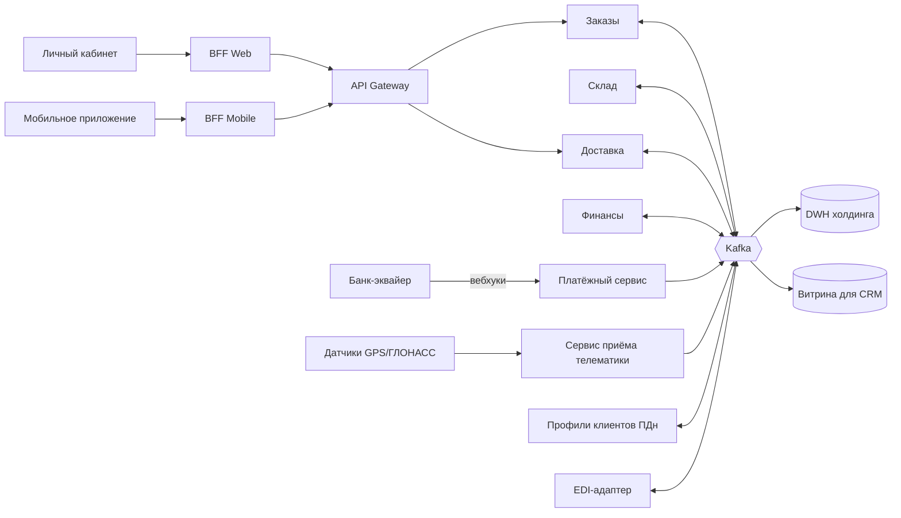

# План архитектурной трансформации Fast Cargo

### 1. Выгоды бизнеса

- Рост в 10 раз без переписывания с нуля. Система выдержит до 500 тыс. отправлений в сутки и 200 RPS на создание заказов. Это нужно, чтобы получить объёмы «Плюс Ритейл».
- Нет простоев из-за отчётов. Отчёты «Финансов» больше не блокируют приём заказов и запись координат. Деньги не теряются из-за остановки продаж.
- Сделка не сорвётся из-за закона. Мы выполняем 152-ФЗ (персональные данные хранятся отдельно) и PCI DSS (данные карт к нам не попадают). Это обязательное условие слияния.
- Ни одного потерянного платежа. Вебхуки банка сначала сохраняются в очередь и только потом обрабатываются, поэтому 0% потерь.
- Быстрые релизы. Каждая команда выкатывает свой сервис отдельно. Вместо двух недель — несколько дней.

### 2. Базовая и целевая архитектура

AS-IS (как сейчас). Монолит с общим BFF и одной базой PostgreSQL. Модули вызывают друг друга напрямую внутри процесса. Шлюз на FastAPI проксирует запросы синхронно.
Главный антипаттерн — «общая база данных» (Shared Database) вместе с «распределённым монолитом». Все домены пишут в одни таблицы, связаны жёсткими ключами, и одна тяжёлая операция тормозит всех.

TO-BE (как будет через год). Событийно-ориентированные микросервисы. Ключевые паттерны:

- Strangler Fig — сервисы постепенно выносим из монолита, пока он не исчезнет.
- Database per Service — у каждого домена своя база («Заказы», «Склад», «Доставка», «Финансы», «Профили клиентов», «Платежи», «Телематика»).
- Шина событий (Apache Kafka) — сервисы общаются событиями, а не прямыми вызовами.
- Saga (оркестрация) + Transactional Outbox — цепочка ORDERS → DESADV → INVOIC проходит по шагам с компенсациями. Счёт не выставляется, пока склад не подтвердил товар.
- CDC (Debezium) — изменения из баз попадают в шину и в DWH без SELECT-запросов.
- CQRS — CRM и аналитика читают отдельные витрины, а не рабочие базы.
- BFF на каждый канал — отдельный BFF для веба и для мобильного приложения.
- Изолированный платёжный сервис — оплата через виджет или редирект банка, номер карты (PAN) к нам не попадает.
- Отдельный сервис профилей (контур ПДн) — паспорт, телефон и e-mail лежат только там, остальные видят только UUID клиента.

### 3. Область применения

Входит в проект (in-scope):

- Монолит Fast Cargo: модули «Заказы», Warehouse, «Доставка», «Финансы» — их вынос в сервисы.
- База PostgreSQL: разделение по доменам, CDC, реплика.
- Интеграционный шлюз и BFF: разделение и перевод на асинхронную работу.
- Новые контуры: EDI-адаптер, приём телематики, сервис профилей (ПДн), платёжный сервис.
- Поток данных в DWH холдинга и витрина для CRM.
- Мониторинг, логирование, CI/CD для новых сервисов.

Не входит в проект (out-of-scope):

- Системы холдинга: DWH, CRM, EDI-провайдер, корпоративная шина. Мы только подключаемся к ним по их стандартам.
- Банк-эквайер, ОФД, платёжный шлюз банка.
- Бухгалтерия, юристы, транспортные подрядчики и их системы.
- Закупка и монтаж датчиков на транспорт (наша часть — только приём данных).
- Редизайн интерфейсов личного кабинета и мобильного приложения.
- Изменение бизнес-процессов логистики.

### 4. Ограничения и допущения

- Сроки: 3 месяца на переходное состояние (аналитика в DWH), 12 месяцев на полный демонтаж монолита.
- Код монолита: в первые 3 месяца не меняем. Дополнительные SELECT на рабочую базу запрещены.
- ИБ: 152-ФЗ, приказ ФСТЭК № 21 (защита ПДн), ГОСТ Р 57580 (финансовые операции), PCI DSS. Данные хранятся в РФ.
- Стек: в основном open source (Kafka, Debezium, PostgreSQL, Kubernetes, Prometheus/Grafana) — нет лицензионных платежей и зависимости от вендора.
- Бюджет: фиксируется на старте; рост затрат на инфраструктуру — не выше заложенного резерва (допущение: 15–20% сверху на пики).
- Допущения: ЦОД холдинга (или managed-облако в РФ) выдаёт ресурсы под Kafka и Kubernetes; PostgreSQL версии 16+ (можно читать WAL с реплики); команда усиливается внешними архитекторами и DevOps.

### 5. Transition Architecture (план на 3 месяца)

| Уровень архитектуры | Текущее состояние (AS-IS) | Переходное состояние (через 3 месяца) | Обнаруженный разрыв (gap) и локация изменений |
|---|---|---|---|
| Данные (Data) | Аналитические и отчётные SELECT идут прямо в рабочую базу PostgreSQL и блокируют таблицы. | Изменения читаются из WAL-логов через Debezium (CDC) с реплики и идут в Kafka, а оттуда в DWH. Отчёты «Финансов» переведены на реплику. | Разрыв — нет отдельного контура для аналитики. Локация — слой хранения: включение логической репликации, реплика для чтения, Debezium. |
| Приложения (Apps) | Шлюз FastAPI синхронно ждёт ответа монолита, тратит воркеры и падает с 504. Вебхуки банка теряются. Общий BFF для веба и мобильного. | Шлюз сразу кладёт вебхук в Kafka и отвечает банку 200 OK. Обработка идёт асинхронно с повторами. Подготовлено разделение BFF на Web и Mobile. | Разрыв — нет буфера между приёмом запроса и обработкой. Локация — middleware: доработка шлюза (не монолита), очередь, ретраи, идемпотентность по ID платежа. |
| Инфраструктура (Infra) | Одна физическая СУБД, все нагрузки на одном инстансе. Нет запаса под рост. | Кластер Kafka (3 брокера), Kafka Connect с Debezium, реплика PostgreSQL, мониторинг Prometheus/Grafana. Разворачиваются в ЦОД холдинга или managed-облаке. | Разрыв — нет потоковой платформы и мониторинга. Локация — ЦОД: выделение серверов, сеть до DWH холдинга. |

### 6. Описание переходного состояния

Решение — Change Data Capture (CDC) на основе WAL-логов (паттерн «Log-based CDC» + шина событий).

Как это работает:

1. PostgreSQL и так пишет каждое изменение в WAL-журнал. Мы включаем логическую репликацию (`wal_level=logical`) — это настройка базы, а не код монолита.
2. Debezium читает WAL с реплики (в PostgreSQL 16+ это можно делать на standby). Рабочая база не получает ни одного лишнего SELECT.
3. Debezium превращает каждую вставку или изменение в событие и пишет его в Kafka (топики `orders`, `waybills`, `invoices` и т.д.).
4. Из Kafka данные идут в DWH холдинга через коннектор. Поля с ПДн (телефон, e-mail, паспорт) маскируются или заменяются на UUID ещё в Kafka Connect (SMT-преобразования).
5. Первичная загрузка истории делается из резервной копии, а не запросами к рабочей базе.

Почему это подходит:

- Задержка 1–3 секунды: изменения уходят сразу после записи в журнал.
- Код монолита не меняется, монолит даже не знает о CDC.
- Нет SQL-нагрузки: чтение журнала — не SELECT, и делается на реплике.
- Это основа будущей архитектуры: та же Kafka станет шиной для микросервисов.

### 7. Дорожная карта, риски и план перехода

Пакеты работ и сроки

- Месяц 1 — фундамент. Инфраструктура: Kafka, Kafka Connect, реплика, мониторинг (инженер эксплуатации + DevOps холдинга). Согласование с ИБ схемы маскирования ПДн.
- Месяц 2 — поток данных. Настройка Debezium и коннектора в DWH (аналитики + разработка). Доработка шлюза: асинхронный приём вебхуков через Kafka (группа разработки).
- Месяц 3 — запуск. Параллельная работа старой и новой схемы, сверка данных (тестировщик + аналитики), переключение отчётов «Финансов» на реплику, ввод в эксплуатацию.
- Месяцы 4–12 — вынос сервисов по Strangler Fig: телематика и платежи → профили (ПДн) → доставка и склад → заказы и финансы с Saga → отключение монолита.

Управление рисками и план отката

- Риск: слот репликации копит WAL и забивает диск, если Debezium остановился. Меры: алерт на размер слота, лимит `max_slot_wal_keep_size`. Откат: удалить слот — база работает как раньше.
- Риск: перезапуск базы при смене `wal_level`. Меры: делаем в ночное окно с минимумом отгрузок, заранее предупреждаем логистику.
- Риск: ошибка в новой обработке вебхуков. Меры: включаем через флаг на шлюзе. Откат: флаг выключается, шлюз снова работает синхронно, как раньше; вебхуки из очереди дообрабатываются.
- Общий план отката: все новые компоненты стоят «рядом», а не вместо старых. Чтобы откатиться, достаточно их выключить — монолит и база остаются нетронутыми.

Критерии успешности и переключение

- Задержка доставки статусов в DWH — не более 5 секунд (p95).
- Расхождение данных между рабочей базой и DWH — 0 при ежедневной сверке количества и контрольных сумм.
- Рост нагрузки на CPU рабочей базы — не более 5%; ошибок 504 на шлюзе — 0; потерь вебхуков — 0%.
- Шаги переключения: 2 недели параллельной работы → сверка → приёмка заказчиком (DWH холдинга) → официальный перевод аналитики на новый поток → отключение старых отчётных запросов.
